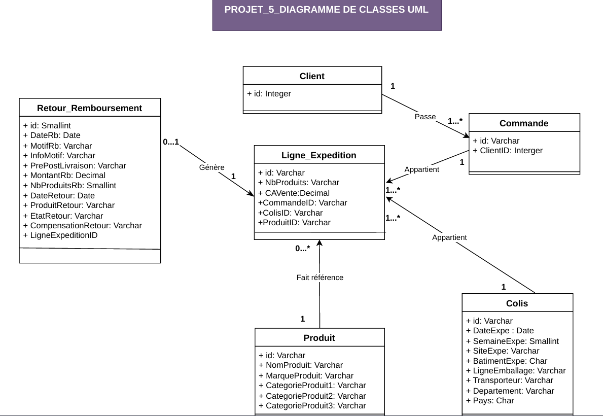

# Manipuler-une-base-de-donnees-avec-SQL-pour-analyser-une-activite-de-retour

Analyse des retours et remboursements avec SQL

## Présentation du projet
L'entreprise Regaload commercialise des produits high-tech, de bricolage, d’ameublement et d’autres catégories. Les retours et remboursements représentent des enjeux financiers, logistiques et environnementaux.
Au sein de l’équipe chargée des remboursements, ma mission est de créer et alimenter une base de données relationnelle reliant les clients, les commandes, les colis, les produits et les remboursements, puis d’exécuter des requêtes SQL pour répondre aux questions métier des équipes financière, logistique, transport et achats : mesurer les montants remboursés, comparer les transporteurs, repérer les problèmes d’emballage et évaluer la valeur récupérée grâce aux retours.

### Problématique
Comment exploiter les données de commandes, d’expéditions et de remboursements pour identifier les principales sources de pertes et améliorer la gestion des retours produits chez Regaload ?

## Objectifs métier
- Quantifier les montants remboursés.
- Identifier les produits et les flux logistiques à investiguer.
- Évaluer la valeur récupérée grâce aux retours.
- Éclairer les décisions des équipes métier pour réduire les pertes.
  
## Jeu de données
Les données de départ sont regroupées dans un tableau unique au format csv contenant les informations sur les clients, les commandes, les produits, les colis, les expéditions et les éventuels retours et remboursements.
Chaque ligne décrit un produit expédié dans un colis pour une commande donnée, avec les informations de remboursement et de retour lorsqu’elles sont renseignées.
Ces données ont été réparties dans une base relationnelle couvrant les expéditions du *1er au 31 mars 2022*, organisée en six tables métier 

| Table | Rôle | Nombre d'enregistrements |
| :--- | :--- | --- |
| Client | Identifiants clients | 143 096 |
| Commande | Commandes et rattachement aux clients | 251 617 |
| Colis | Dates, transporteurs et informations logistiques | 263 853 |
| Produit | Références, marques et catégories | 26 727 |
| Ligne_Expedition | Produits expédiés, quantités et chiffre d’affaires | 319 820 |
| Retour_Remboursement | Motifs, montants remboursés et devenir des produits | 13 778 |

La table Ligne_Expedition relie les commandes, colis et produits. Chaque enregistrement de Retour_Remboursement est rattaché à une ligne d’expédition.
Cette organisation limite la répétition des informations et permet de croiser les données grâce aux clés primaires et étrangères. Le dictionnaire de données documente les champs, les types, les contraintes et les règles de calcul.
Le dictionnaire décrit les champs, les types, les contraintes et les règles de calcul. Les dates sont stockées comme chaînes de caractères dans la base fournie.



## Outils
- **SQLite** : moteur de la base, stockée dans un fichier.db
- **Letos 4.0.1 (anciennement SQLiteStudio)** : interface utilisée pour manipuler la base et exécuter les requêtes.
- **Excel** : dictionnaire de données et documentation des questions, requêtes et résultats.
- **dbdiagram.io** : conception du schéma relationnel.

## Méthodes SQL utilisées
- Jointures *LEFT JOIN* pour relier les tables.
- Filtres *WHERE* pour sélectionner les données pertinentes.
- Agrégations *SUM* et *COUNT* pour calculer les montants et compter les enregistrements.
- Regroupements *GROUP BY* pour comparer les résultats par catégorie.
- Tris *ORDER BY* pour classer les résultats.
- Expressions communes *WITH* pour structurer les requêtes.
- Arrondis *ROUND* et utilisation de *NULLIF* pour éviter certaines divisions par zéro.

## Démarche d’analyse
1. Explorer et documenter les champs utiles aux questions métier.
2. Modéliser les entités et leurs relations.
3. Créer et alimenter les six tables de la base SQLite.
4. Interroger les données pour les équipes marge, retours, transport, logistique et achats.
5. Comparer les montants, les ratios et les segments pour éclairer les décisions.

Les questions  business portent sur les remboursements, les motifs de retour, la compensation, les transporteurs, les flux non livrés, les départements, les avaries et les marques de multicuiseurs.

## Chargement des données
L'étape nettoyage et préparation des données m'a permis de créer un fichier csv pour chaque table. Une fois les six tables créées dans SQLite, j'ai chargé les données de chaque fichier dans la table correspondante à l'aide de l'assistant d'import Letos. 

## Analyses métier — exemples
````sql
-- Quel est le montant total d’émission de remboursements clients ?
SELECT SUM(Montant_Rb) AS Montant_Total_Remboursements FROM Retour_Remboursement;
````
Résultat: **2 288 004€**
Ce montant donne une première mesure de l’enjeu financier. Il correspond aux remboursements enregistrés, et non à une perte nette après compensation.

```sql
-- Calculer le montant total de compensation récupérée et le montant total remboursé pour les produits ayant été physiquement retournés, afin d'en déduire le taux de compensation. La part du remboursement récupéré grâce à la revalorisation du produit retourné.
SELECT
rr.Motif_Rb,
ROUND(SUM(rr.Montant_Rb) / SUM(le.CA_Vente),2) AS Taux_de_Remboursement
FROM Ligne_Expedition le
LEFT JOIN Retour_Remboursement rr ON le.id=rr.Ligne_ExpeditionID
GROUP BY rr.Motif_Rb;
```
Résultat: l'entreprise récupère **1 267 983€, soit 55,42%** du montant total des remboursements. 
Regaload rembourse le client, puis peut récupérer de la valeur en remettant le produit en stock ou en le revendant à prix réduit. La question mesure cette récupération.
```sql
-- Calculer pour chaque marque de multicuiseur le CA total,le montant total remboursé et le taux de remboursement, filtre sur la catégorie produit "Multicuiseur Electrique" afin d'identifier la marque qui génère le moinns de remboursements et donc satisfait le mieux les clients
SELECT 
p.Marque_Produit AS Marque,
ROUND(SUM(le.CA_Vente),2) AS Chiffre_affaires,
ROUND(SUM(rr.Montant_Rb),2) AS Total_remboursements,
ROUND(SUM(rr.Montant_Rb) / NULLIF (SUM(le.CA_Vente),0)*100,2) AS Taux_remboursement
FROM Ligne_Expedition le
LEFT JOIN Produit p ON le.ProduitID=p.id
LEFT JOIN Retour_Remboursement rr ON rr.Ligne_ExpeditionID=le.id
WHERE p.Categorie_Produit_lvl_3 ='MULTICUISEUR ELECTRIQUE'
GROUP BY p.Marque_Produit
ORDER BY Taux_remboursement ASC;
```
Résultat
| Marque | CA | Remboursements | Taux de remboursement |
| --- | :--- | --- | --- |
| SEB599 | 28 701,24 € | 585,95 €	| 2,04 % |
| TEF601 | 28 217,53 € | 1 155,13 € |	4,09 % |
| MOU627 | 70 028,27 € | 3 503,17 € | 5,00 % |

Cet indicateur aide à comparer les marques, sans mesurer directement la satisfaction client ni expliquer les causes des écarts.

## Enseignements et limites
Le modèle relationnel permet de relier les dimensions produit, commande, transport et remboursement. Les requêtes rendent les questions métier mesurables et mettent en évidence des différences à approfondir.
- Le périmètre d’expédition couvre un mois : il ne permet pas de conclure sur une saisonnalité annuelle.

Livrables:
[Script_tables](Script_requêtes_BDD_Regaload.sql)

[Questions_business](Questions_business_Regaload.sql)

[Schéma relationnel](<_2_schéma relationnel_052026.pdf>)
